<!-- In the design of furkanboran.info: every banner is one of the site's scenes, drawn as an animated SVG. -->

<a href="https://www.furkanboran.info"></a>

  <a href="https://www.furkanboran.info"></a>
  
  
  <a href="https://x.com/boranfurkan34"></a>
  


I'm a full-stack engineer in London. I turn Figma files into fast React and Next.js front ends, then back them with Node.js and Python APIs that hold up. 40+ client projects shipped so far.

🟢 **Open to full-time roles and freelance projects.**



**01 · From the first Figma frame to the last deploy.** Full-stack features across 40+ client projects, with Figma designs turned into reusable React and Next.js component libraries that score 90+ on Lighthouse.

**02 · I'm at home on every layer.** Multi-tenant platforms secured with OAuth/JWT and role-based access. I owned the PostgreSQL schema and Prisma migrations, plus the background jobs and transactional email underneath.

**03 · Lately, I've been working in real time.** The entire Next.js 15 / React 19 frontend for a multiplayer quiz game that turns uploaded documents into AI-generated quizzes, kept in sync live over WebSockets.

**04 · Deploys shouldn't need a prayer.** Apps containerised with Docker, shipped through GitHub Actions to AWS and Vercel, with Sentry keeping an eye on production.


Started university in Riga, interned remotely for a team in Cologne, then finished with First-Class Honours at the University of Greenwich.


<table>
<tr>
<td width="50%" valign="top">
<a href="https://www.furkanboran.info/#work/reproducer">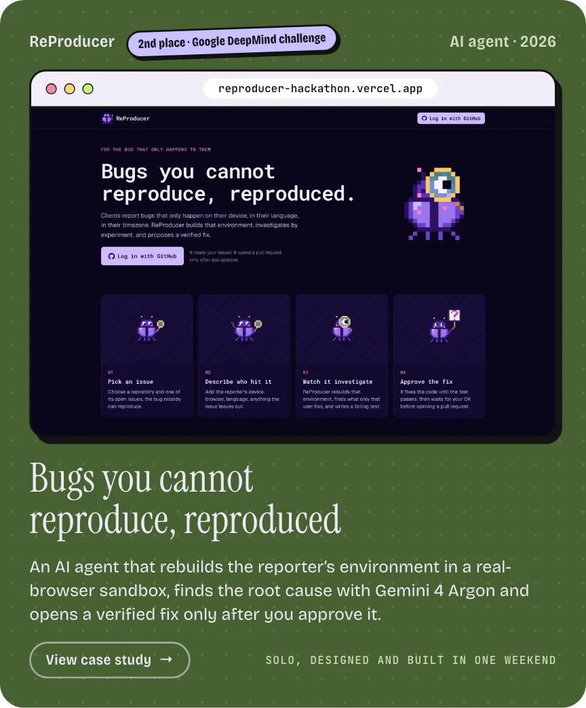</a>

<a href="https://reproducer-hackathon.vercel.app/">Live demo</a> · <a href="https://github.com/boranfurkan/reproducer-hackathon">GitHub</a>

</td>
<td width="50%" valign="top">
<a href="https://www.furkanboran.info/#work/plan-b">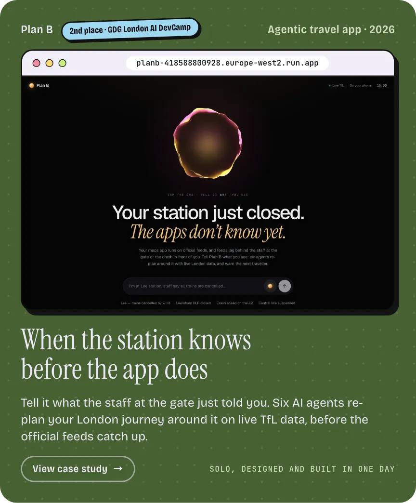</a>

<a href="https://planb-418588800928.europe-west2.run.app/">Live demo</a> · <a href="https://github.com/boranfurkan/planb">GitHub</a>

</td>
</tr>
<tr>
<td width="50%" valign="top">
<a href="https://www.furkanboran.info/#work/holo-grails">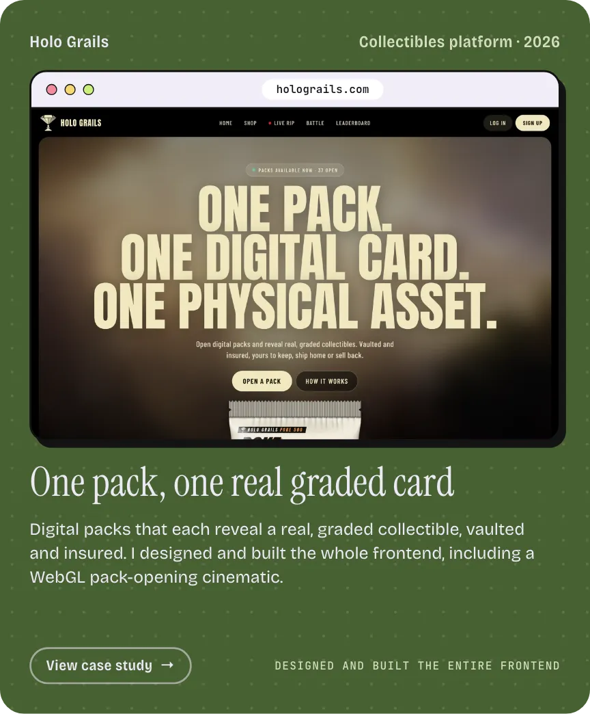</a>

<a href="https://www.holograils.com/">Visit site</a>

</td>
<td width="50%" valign="top">
<a href="https://www.furkanboran.info/#work/geomapper">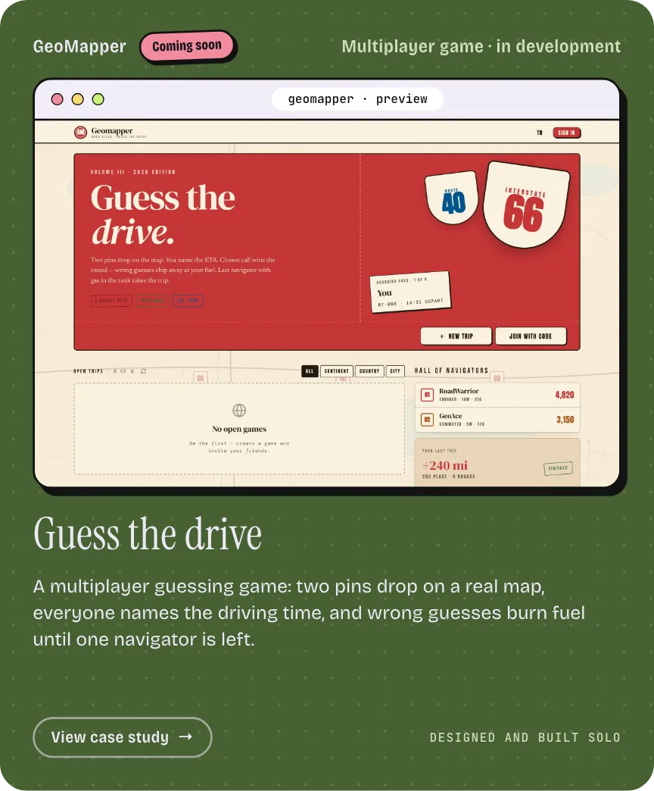</a>

Coming soon

</td>
</tr>
</table>

Client sites, an open-source React library and more on <a href="https://www.furkanboran.info">furkanboran.info</a> · <a href="https://github.com/boranfurkan?tab=repositories">All repositories</a>


I own every stage, from the Figma file to the Docker deploy. 40+ client projects at a London agency, an open-source React library on npm, and the frontend of a real-time, AI-powered product.

<table>
<tr>
<td width="33%" valign="top"><b>EDUCATION</b> BSc (Hons) Software Engineering, First-Class, University of Greenwich</td>
<td width="33%" valign="top"><b>EXPERIENCE</b> Full-Stack Developer, DegenDevs · Software Engineer Intern, Advanced Dynamics</td>
<td width="33%" valign="top"><b>CERTIFICATE</b> Meta Front-End Developer Professional Certificate</td>
</tr>
</table>

<a href="mailto:furkanboran123@hotmail.com"></a>

  
  
  
  
  

Building something that deserves to ship well? Let's talk. · This page mirrors <a href="https://www.furkanboran.info">furkanboran.info</a>, scene by scene.

